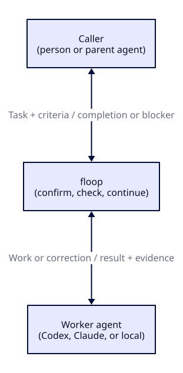

# floop

floop is a supplementary Codex skill for closing the acceptance loop on delegated AI work. It helps a caller turn requirements into checkable criteria, review available evidence, request bounded corrections, and report whether the work is complete.

floop is an installable skill, not a standalone service. It does not include a runtime adapter, live-session monitor, command-line tool, or persistent run store. The host must provide any session controls and evidence that are available during a run.

## Install

Clone floop and link the skill into your user-level Codex skills directory:

```sh
mkdir -p ~/.local/share
git clone https://github.com/kobaltoxid/floop.git ~/.local/share/floop
~/.local/share/floop/scripts/install-user.sh
```

The installer creates `~/.agents/skills/floop` as a symlink to this checkout. It refuses to replace an existing file, directory, or symlink that points somewhere else. Start a new Codex session after installation.

To install into Claude Code's personal skills directory as well, opt in explicitly:

```sh
~/.local/share/floop/scripts/install-user.sh --claude
```

Claude Code reads skills from `$CLAUDE_CONFIG_DIR/skills` when `CLAUDE_CONFIG_DIR` is set, and from `~/.claude/skills` otherwise. The installer follows the same rule. If you keep several Claude Code profiles, such as separate personal and work accounts, run the installer once per profile:

```sh
CLAUDE_CONFIG_DIR=~/.claude-work ~/.local/share/floop/scripts/install-user.sh --claude
```

Repeat runs are safe; links that already point to this checkout are reported as `Already linked`. The Claude installation is only a compatible skill link; floop's documented workflow and primary target remain Codex.

Every link points to the same checkout. To update floop for all profiles, run `git -C ~/.local/share/floop pull` and start a new session.

## Use

Invoke `$floop` in Codex or `/floop` in Claude Code when you want to supervise one delegated task. Provide the task, its acceptance criteria (or a file containing them), and the worker result or session reference that the host exposes. The skill confirms the contract, evaluates each criterion as `pass`, `fail`, or `unknown`, and returns a concise disposition: `complete`, `needs-caller`, or `limit-reached`.

If the host cannot expose a worker session, floop can review artifacts supplied by the caller, but it labels the run `review-only` and never claims to have monitored or continued a live session.

## Completion loop

The caller, a person or a parent agent, confirms the acceptance criteria before floop evaluates the worker's result. The worker may be a Codex, Claude, or local agent. floop records evidence for each criterion. When a required check fails, it sends a focused correction to the same worker and rechecks the result, up to two times by default.



Figure 1. floop loops with the worker until every required criterion passes or a blocker remains. See the [D2 source](docs/diagrams/completion-loop.d2) or [PNG preview](docs/diagrams/completion-loop.png).

## Project documents

- [System design](docs/system-design.md) — the proposed completion loop and capability limits.
- [Acceptance contract](docs/acceptance-contract.md) — requirement inputs, outcomes, and continuation policy.
- [Product scope and decisions](docs/rough-shape.md) — the product boundary and open runtime questions.
- [Skill definition](skills/floop/SKILL.md) — the workflow loaded by Codex.

## License

floop is licensed under the [Apache License, Version 2.0](LICENSE).
