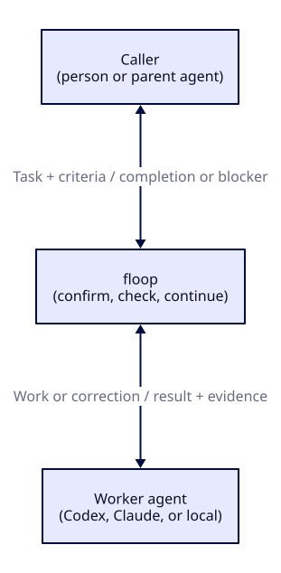

# System Design

## Goal and constraints

This design describes how floop checks completed agent work against a caller-confirmed contract and either closes the run or requests a focused continuation.

- **Reader:** contributors maintaining the skill and planning possible runtime adapters.
- **Goal:** make task completion evidence-based while keeping the caller at the goal and policy level.
- **Constraints:** the caller can be a person or a parent agent; worker runtimes differ; continuations must be bounded.

The initial release is an installable Codex skill. It runs inline by default and can use one dedicated supervisor session when requested, if the host supports session control. Runtime adapters, durable storage, and live session control are not included.

## Context and components

The caller supplies the task, requirements or their source, and a worker session or session reference. A parent orchestrator may select the worker. The supervisor does not need to start or schedule agents itself; it needs a way to observe and continue a connected session.

The diagram reduces the design to three roles and two exchanges. Each double-headed arrow pairs a message with its reply; the slash separates the two directions.

Figure 1. The supervisor exchanges a task and outcome with the caller, and work and evidence with the worker. See the [D2 source](diagrams/completion-loop.d2) or [PNG preview](diagrams/completion-loop.png).

The proposed components have these responsibilities:

- **Run coordinator:** advances the run through contract confirmation, observation, evaluation, continuation, and final reporting.
- **Requirement resolver:** reads criteria from invocation input or an explicitly selected file, and asks the caller when the contract is missing or unclear. Issue trackers such as Jira are possible future sources.
- **Runtime adapter:** identifies or attaches to a session, detects completion, collects results and evidence, and sends continuation requests. Which runtimes can support these operations is not yet known.
- **Verifier:** evaluates each criterion as `pass`, `fail`, or `unknown`, with evidence and a reason. It can combine deterministic checks with model review where the criterion requires judgment.
- **Run record:** returns the confirmed contract, evidence references, check outcomes, continuation attempts, and final disposition to the caller. Durable storage is not implemented.

The initial skill keeps this run record in its response to the caller. A persistent store is a later implementation decision.

## Completion flow

1. The caller opens a run with a task, any available requirements, and a worker session or session reference.
2. The resolver builds a checkable contract and confirms it with the caller before monitoring begins. Conflicts or missing criteria go back to the caller for clarification.
3. The coordinator waits for the runtime adapter to detect completion, then gathers the result and available evidence.
4. The verifier evaluates every criterion and records its outcome and evidence.
5. If all required criteria pass, the coordinator records and reports completion. If a required criterion fails, it sends a focused correction request to the same worker session and evaluates the result again.
6. A required `unknown`, inaccessible evidence, a runtime limitation, or an exhausted retry/time/cost limit returns the unresolved items to the caller. The caller may be a person or a parent agent.

## Trade-offs and failure behavior

- A common adapter contract makes the coordinator runtime-neutral, but some runtimes may not expose completion signals, evidence, or session continuation. The adapter must report unsupported operations; the supervisor must not claim to have checked work it could not inspect.
- Model review can assess criteria that lack a simple command, but every outcome still needs a recorded reason and evidence. An unknown result cannot count as a pass.
- The initial skill allows two continuation requests by default. Reaching the limit produces a caller-visible unresolved result, not a successful completion.
- A separate supervisor session needs a worker session reference and host support for observation and continuation. Without that access, it can review supplied artifacts but cannot claim to monitor a live worker.
- Continuation requests stay within failed criteria. Expanding scope requires the caller to update and reconfirm the contract.

See [Product Scope and Decisions](rough-shape.md) for choices that remain open before implementation.
